<p align="center">
  
</p>

<h1 align="center">jar</h1>

<p align="center">
  <a href="https://jar-pearl.vercel.app"><b>jar-pearl.vercel.app</b></a>
</p>

<p align="center">
  
  
  
  
  
</p>

**A garden shed at night, and a city in a jar.** On the potting table stand three
glass jars glowing like lanterns. One holds a tiny **Warsaw**, another the
cliff and the giant wave of **Nazaré**, the third **Fitz Roy** seen from the
shore of the lake below El Chaltén. Each is lit for the real time of day
there right now and drawn under the weather that place is really having. A label
on each glass gives the city and country, the temperature and the local time,
on Nazaré's jar the swell as well, and on El Chaltén's whether you can see
Fitz Roy today.


The picture above is one moment: evening in Warsaw, the last half hour of sun
in Nazaré and early afternoon in Patagonia. Nothing in it is a photograph or an
image file; every jar is drawn in code, every frame.

## What you can do

- **Click or tap a jar** and it lifts closer, with a five-day forecast card
  beside it (under it on a phone). Until you lift one for the first time, a
  chalked slate on the table says so.
- **Press the lifted jar** and it shakes: it leans, the scene sloshes, and a
  flurry lifts off the floor of the jar and settles (snow when it is cold
  there, warm glitter when it is not).
- **Drag the slider** under the jar to preview the next 24 hours: the light and
  the hourly weather move with it and the label says how far ahead you are
  ("+5 h"). Let go, or press *now*, and the jar returns to the present.
- **Press *play*** and the next 24 hours run by in twenty seconds.
- **Click a day on the card** and the jar shows that day's early afternoon;
  click it again, or press Escape, to come back.
- **Arrows, the arrow keys or a swipe** move to the next jar. Escape or *back
  to the table* sets the jar down.
- **Move the pointer** and the scene slides a little behind the glass, as it
  would if you leaned to one side.

The shed's own window follows *your* clock, not any city's, and its moon is the
real one: the right phase for tonight, almost gone at new moon. If your system
asks for reduced motion, the page calms down: the jar does not shake, the
time-lapse steps an hour at a time, the clouds barely drift and a storm draws
no bolt.

## The three jars

### Warsaw

<table>
  <tr>
    <td width="50%">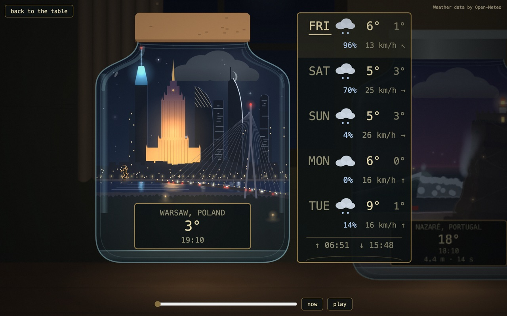</td>
    <td width="50%">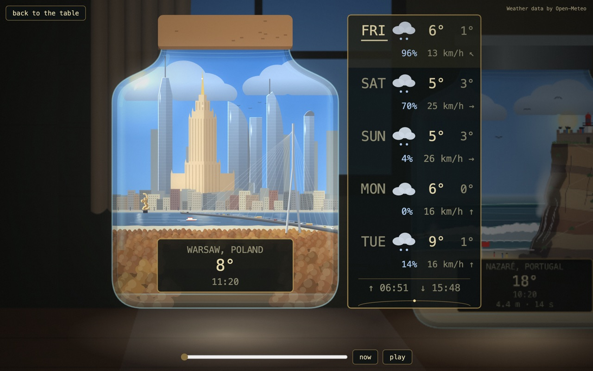</td>
  </tr>
  <tr>
    <td align="center"><b>Night.</b> The Palace glows gold, Varso's crown glows blue, and the city reflects in the river. Windows go out one by one as the night gets late.</td>
    <td align="center"><b>Day.</b> Each tower has a bright edge on the side the sun is on. The forest on the near bank follows the seasons.</td>
  </tr>
</table>

The skyline is the downtown cluster: the Cosmopolitan, Varso, the Palace of
Culture and Science, Warsaw Spire, Złota 44 and the InterContinental, with the
Świętokrzyski bridge across the Vistula and the Mermaid on the left bank with
her sword raised. Around them the jar has a small life of its own:

- a **boat** crosses the river by day, **birds** cross the sky in fair weather,
  and traffic runs over the bridge;
- in a hard frost the river carries **ice** and **steam** rises from a few
  roofs, leaning with the wind;
- a **Christmas tree** stands at the Palace's foot from 6 December to
  6 January, and there are **fireworks** over the skyline from 23:55 on New
  Year's Eve to 00:20;
- in a thunderstorm, every other bolt strikes the Palace's needle.

### Nazaré

<table>
  <tr>
    <td width="62%">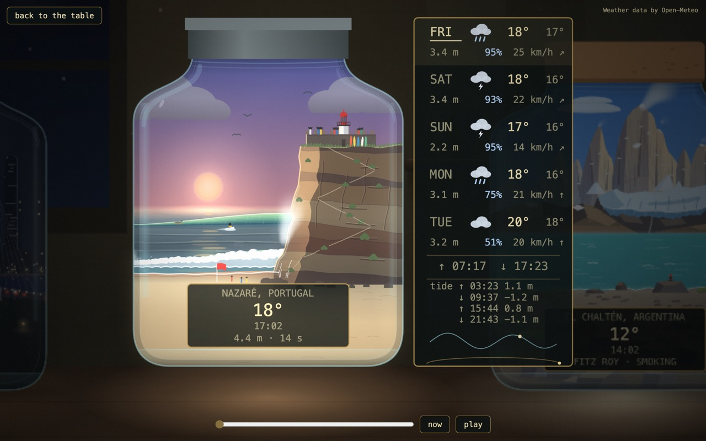</td>
    <td width="38%">
      <b>A wave sized by the real sea.</b> The Sítio headland, the São Miguel Arcanjo fort and its lighthouse stand above the Praia do Norte wave. The view faces west, so this jar has its own sun, which sets into the sea.<br><br>
      The label adds the swell (height · period) as a fourth line. The card gives each day's peak wave height and today's high and low tides with their heights, over a small tide curve with a dot for now. Slide the time ahead and the wave resizes to the forecast swell for that hour.<br><br>
      By day surfers ride the wave and people watch from the fort's roof. On a warm, fair, gentle day umbrellas come out on the sand; on a big day the red flag goes up. At night the lighthouse beam sweeps the foam and fishing boats show their lights on the horizon. The jar keeps Lisbon time and wears a tin lid.
    </td>
  </tr>
</table>

The wave follows the real wave height off the coast, in four sizes. With no
reading it shows a moderate two-metre day.

<table>
  <tr>
    <td width="25%">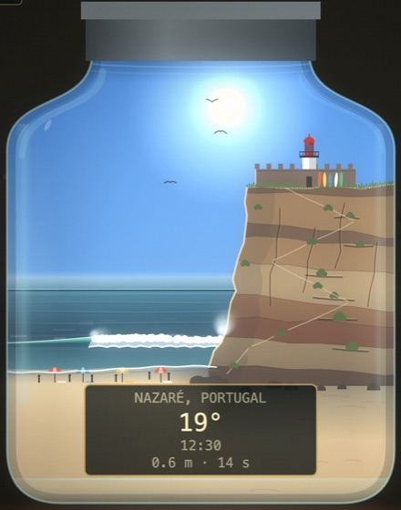</td>
    <td width="25%">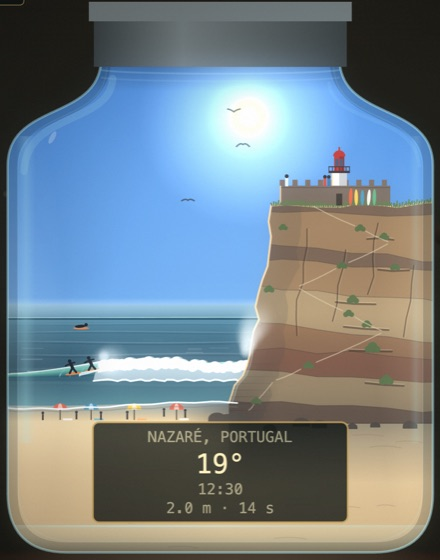</td>
    <td width="25%">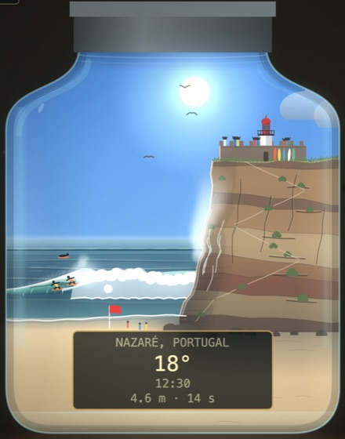</td>
    <td width="25%">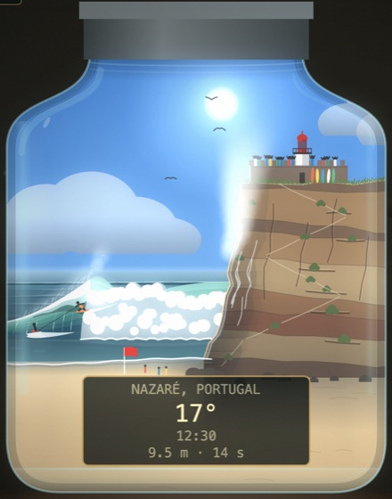</td>
  </tr>
  <tr>
    <td align="center"><b>Calm</b><br>under 1 m</td>
    <td align="center"><b>Moderate</b><br>1–3 m</td>
    <td align="center"><b>Big</b><br>3–6 m</td>
    <td align="center"><b>Giant</b><br>from 6 m</td>
  </tr>
</table>

### El Chaltén

<table>
  <tr>
    <td width="50%">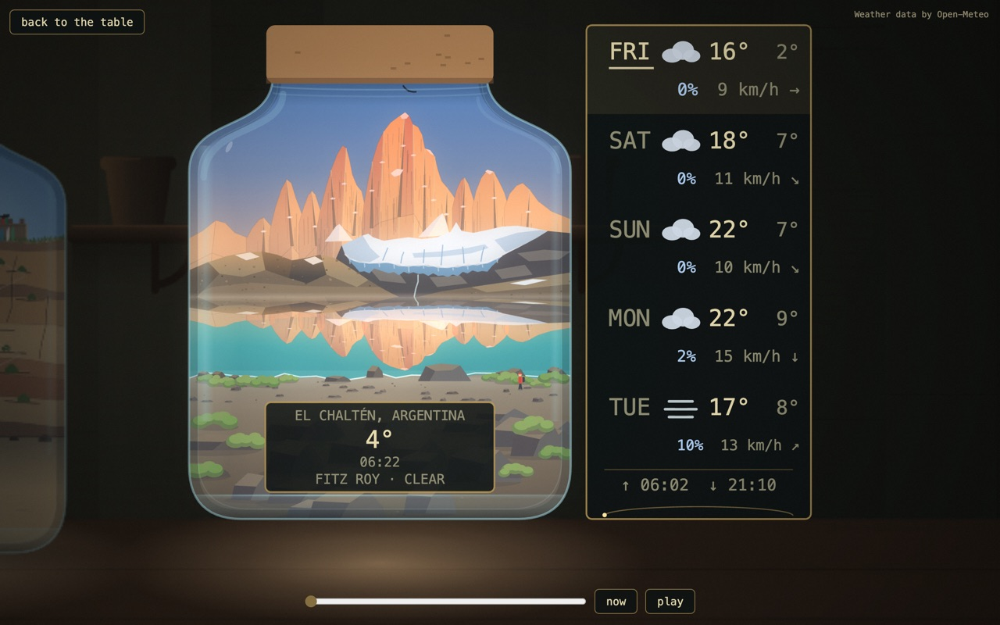</td>
    <td width="50%">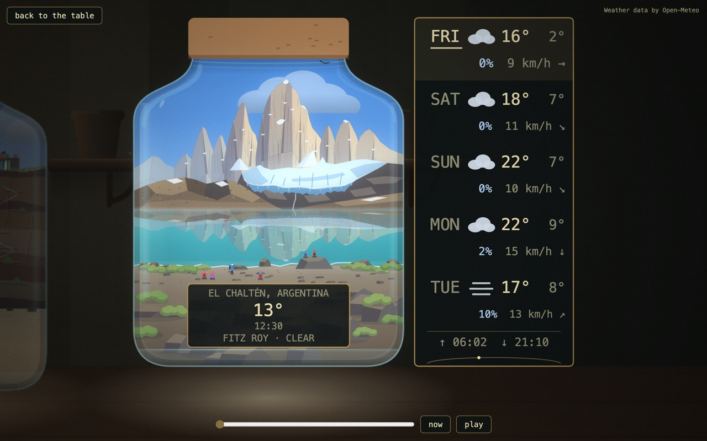</td>
  </tr>
  <tr>
    <td align="center"><b>First light.</b> It lands on the summit and walks down the wall after sunrise. In still air the lake mirrors it.</td>
    <td align="center"><b>Midday.</b> Faceted granite, shaded by the hour, with hikers on the shore by day.</td>
  </tr>
</table>

Not the town but the view from the east shore of Laguna de los Tres, looking
west: the blade of Poincenot and the fin of Fitz Roy with smaller needles
stepping down beside them, the glacier, the moraine, the lake and a gravel
shore. It answers the question the whole town asks each morning, *can you see
Fitz Roy today?*, from the real cloud, weather and wind, and the label's fourth
line says which:

<table>
  <tr>
    <td width="25%">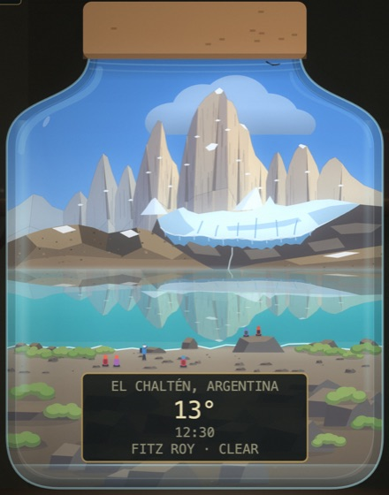</td>
    <td width="25%">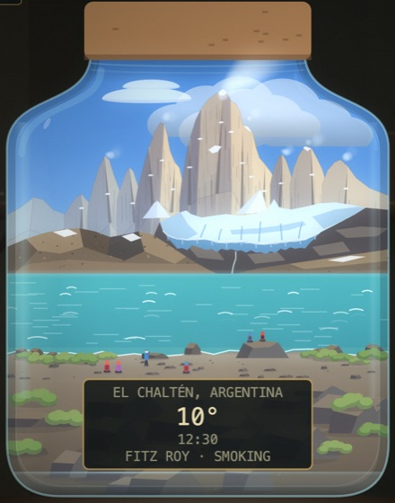</td>
    <td width="25%">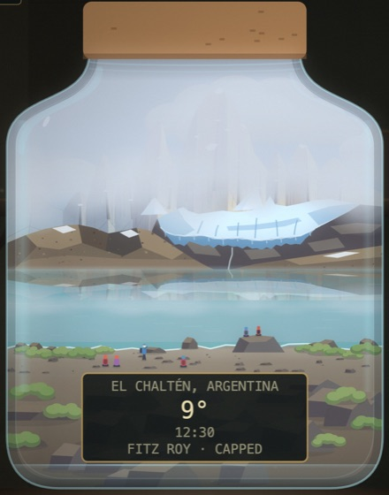</td>
    <td width="25%">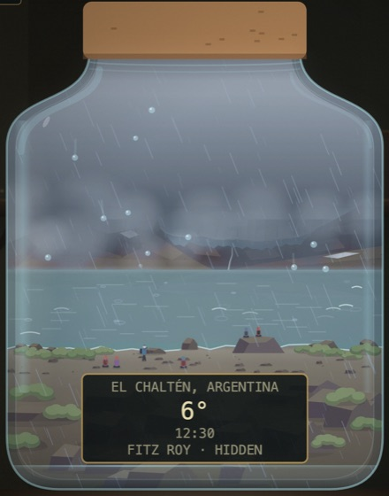</td>
  </tr>
  <tr>
    <td align="center"><b>Clear</b></td>
    <td align="center"><b>Smoking</b><br>cloud under 60 %, wind from 25 km/h: a banner cloud streams off the summit the way the wind blows</td>
    <td align="center"><b>Capped</b><br>cloud 60 % and over: a deck sits on the summits</td>
    <td align="center"><b>Hidden</b><br>cloud 85 % and over, or fog, rain, snow or a storm</td>
  </tr>
</table>

With no reading the peak is drawn clear with a short plume and there is no
fourth line. The sun sets behind the wall; a few headlamps wait on the shore in
the last ninety minutes before sunrise; a condor circles when there is wind to
carry it; and the seasons run the southern way round, with a frozen white lake
from June to August. The jar keeps El Chaltén's own time
(`America/Argentina/Rio_Gallegos`) and wears a cork lid.

## Real weather

Each jar is drawn under the weather its place is having now: clear, broken
cloud, overcast, fog, drizzle, rain, snow and thunderstorms, with the wind
setting how fast the clouds travel and how far the rain leans.

<table>
  <tr>
    <td width="25%">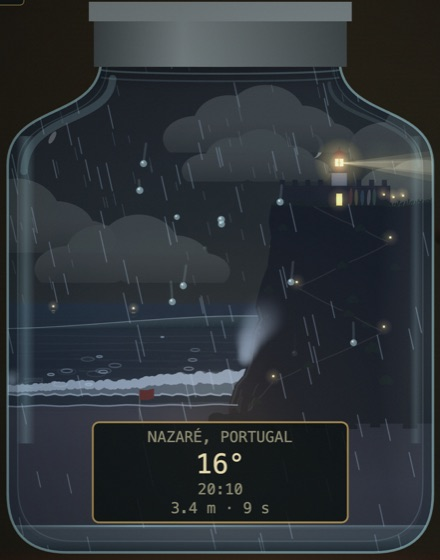</td>
    <td width="25%">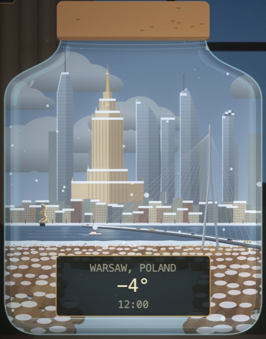</td>
    <td width="25%">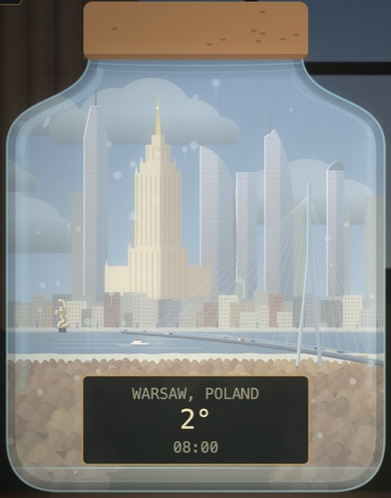</td>
    <td width="25%">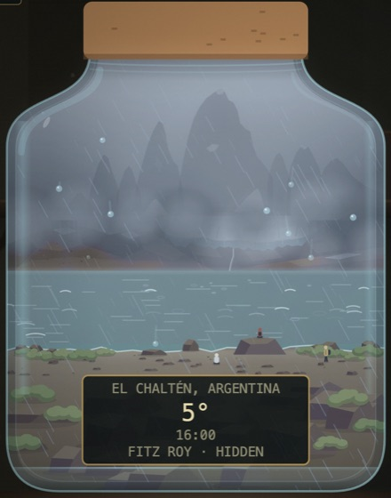</td>
  </tr>
  <tr>
    <td align="center"><b>Rain</b> falls in two layers, behind the city and in front of it, lands as rings on open water and runs down the glass in beads.</td>
    <td align="center"><b>Snow</b> falls in three depths and settles on the roofs.</td>
    <td align="center"><b>Fog</b> mists the inside of the glass. When it clears it leaves dew.</td>
    <td align="center"><b>A heavy sky</b> turns grey whatever the hour, hides the sun and drains the colour from the scene.</td>
  </tr>
</table>

<table>
  <tr>
    <td width="62%"></td>
    <td width="38%"></td>
  </tr>
  <tr>
    <td align="center"><b>Lightning.</b> A storm flashes at intervals and draws a forked bolt; the flash lights the room around the jar too. When a new reading changes the sky, the old one fades into the new.</td>
    <td align="center"><b>Phone and laptop</b> share one drawing, so the jars look the same on both. On a phone the forecast moves under the jar and a swipe moves between jars.</td>
  </tr>
</table>

The forecast card marks today with a band and an underline (and names it
*today* for screen readers). Each day gives its high and low, its chance of
rain and its strongest wind with an arrow for the way it blows; a strip along
the bottom gives today's sunrise and sunset over a thin arc whose dot shows how
far the sun has come across the sky. If the weather cannot be fetched, the jars
still light for the hour under a neutral sky and the label shows a dash instead
of a temperature.

## How it's made

One static page with Canvas 2D and ES modules. There is no build step and there
are no runtime libraries; everything is drawn in code. One small Vercel Node
function (`api/weather.js`) fetches the weather for every city from Open-Meteo,
and the wave height for any city by the sea from Open-Meteo's marine service, in
parallel. Neither needs a key, and a failed marine answer never fails the
weather: the wave just falls back to two metres. The data is Open-Meteo's, published under CC BY 4.0 as a free API for non-commercial use, which is why the page carries a small "Weather data by Open-Meteo" credit.

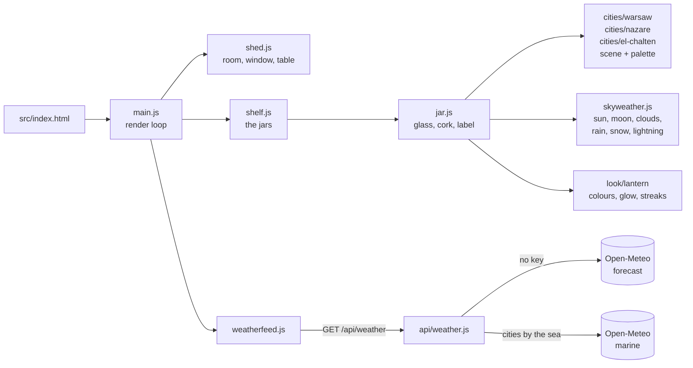

- **The look is called Lantern.** It is named in exactly one place,
  `src/look/index.js` (`export const LOOK = 'lantern'`). Every colour, lighting
  rule and drawing primitive lives under `src/look/lantern/`.
- **A city's colours live in its own palette.** The lint fails on a colour
  literal anywhere else under `src/`.
- **The same moment draws the same picture.** Draw code never calls
  `Math.random` or reads the wall clock, and the smoke check hashes a pinned
  frame twice to prove it.
- **A city only draws its place.** The sky, the weather and the glass are
  shared (`src/skyweather.js`, `src/jar.js`); a city supplies its scene, its
  palette and, if it wants them, a label line, a redraw interval, a rectangle
  of open water for the rain to land on and a point for lightning to strike.
- **Frames stay cheap.** The static art is built once, the room behind a
  lifted jar is kept between frames, and the page only redraws as often as
  the weather or a moving scene asks for.
- The clock logic is adapted from Memory Lane, an earlier project by the same
  author, and credited in the file headers. None of the visual code comes from
  there.

## Quick start

```bash
npm install
npm run serve        # http://localhost:5173  (PORT=... to change it)
```

**You'll see:** the shed, with the Warsaw, Nazaré and El Chaltén jars glowing on the table.
Open <http://localhost:5173/?jar=warsaw>, <http://localhost:5173/?jar=nazare> or
<http://localhost:5173/?jar=el-chalten>
to start with that jar already lifted.

The local server also answers `GET /api/weather` with the real function. To
try a particular weather without waiting for it, answer the weather from a
file (dev only):

```bash
WEATHER_FIXTURE=test/fixtures/weather-storm.json npm run serve
# also: weather-hail.json, weather-fog.json, weather-nowind.json, weather-cloudy-wind.json

# every jar from one file (an array with one vendor body per place, in registry order), and the sea on demand:
WEATHER_FIXTURE=test/fixtures/weather-two-cities.json \
MARINE_FIXTURE=test/fixtures/marine.json npm run serve
```

With only `WEATHER_FIXTURE` set, the marine call is refused, so a fixture run
never reaches the network and Nazaré shows its two-metre default.

To see dew, open the page with the fog fixture, then run this in the browser
console:
`__jar.applyWeather({"current":{"temperature_2m":9,"weather_code":0,"cloud_cover":5,"is_day":1}})`

### URL options

| Option | What it does |
|---|---|
| `?jar=warsaw`, `?jar=nazare`, `?jar=el-chalten` | Opens straight onto that jar, lifted. |
| `?day=`, `?at=`, `?clock=` | Parsed by `readOptions` for a later card. The page always runs on the real clocks. |

## Gates

```bash
npm run lint                      # syntax + house rules (tools/lint.mjs)
npm test                          # unit tests (node --test)
SMOKE_TIMING=off npm run smoke    # headless Chromium; drop SMOKE_TIMING=off to hold frame budgets
```

The smoke check drives a real page in a headless browser. It pins a Warsaw night and a Warsaw
morning and samples pixels to check the gold Palace, the blue crown, the red
light, the reflections, the Mermaid's rim and the morning rim. For Nazaré it
checks both labels, both lifts, moving between jars by arrow and by swipe, the
four wave sizes and their surfers, and the lighthouse beam at night. For El Chaltén
it checks the label's four bands and the missing-weather three lines, the
turquoise lake, the banner cloud, the deck, first light on the wall and its
mirror, the headlamps, the bivouac light, the frozen July lake, that the facets
are lit by the hour and that a pinned moment draws the same pixels. It also
checks the forecast card's today mark, sunrise and sunset strip and sun arc,
and that clouds hold their place when the wind changes. Its screenshots
go to `test-output/`. It needs a
Chromium: run `npx playwright-core install chromium-headless-shell`, or it
falls back to an installed Chrome. The weather is stubbed in every test and in
the smoke check, so nothing touches the network.

## Adding a city

1. Add `{ id, title, country, lat, lon, zone }` to `src/cities/places.js`.
   Append, never insert: the order is the weather request's order. An optional
   `sea: { lat, lon }` is an offshore point the weather function also reads the
   wave height at; a city without one makes no marine call. A city with a `sea`
   point also gets the swell as a fourth label line and a peak wave height per
   day on its card.
2. Copy `src/cities/warsaw/` to `src/cities/<id>/`, write its `palette.js` and
   scene, and fill in `index.js`, including `country: place.country`. The
   contract is the comment at the top of `src/cities/index.js`. A scene that
   moves on the clock (like Nazaré's rolling sea) can export
   `cadenceMs(weather, { reduced })`, the milliseconds between redraws it needs;
   the page redraws at the shortest interval any city or the weather asks for.
3. Import it and add it to `CITIES` in `src/cities/index.js`.

`npm run lint` fails if a city folder is listed in only one of the two
registries. Each jar holds one city.

## Switching the look

To switch looks, add `src/look/<name>/` exporting the same surface as Lantern.
The list of exports is in `src/look/index.js` and is checked by
`test/look.test.js`. Then change the `LOOK` constant and the `export * from`
line. The other candidates are **Toybox** (bright isometric, flat-shaded
low-poly) and **Pixel** (a cosy pixel-art diorama).

## Hosting

`vercel.json` publishes `src/` as it is and gives every response a self-only
CSP (`connect-src 'self'`): the page only ever talks to its own `/api/weather`,
and the function is the only thing that calls Open-Meteo. `/api/*` is cached for
15 minutes at the edge.

- **A pull request** gets a preview deploy.
- **A push to `main` goes live**, after the gates pass. The deploy runs from
  `.github/workflows/deploy.yml` with a pinned Vercel CLI.

You need to create the Vercel project and its three secrets yourself:
`VERCEL_TOKEN`, `VERCEL_ORG_ID` and `VERCEL_PROJECT_ID`.

## What's in the repo

| Folder | What it is |
|---|---|
| `src/` | The page: everything a visitor's browser loads. |
| `api/` | The one weather function. |
| `test/`, `tools/` | The unit tests, the lint, the local server and the smoke check. |
| `docs/` | The architecture notes ([`docs/context.md`](docs/context.md)) and the pictures above. |
| `.claude/`, `.agents/`, `.codex/`, `.grok/`, `profile/`, `AGENTS.md`, `CLAUDE.md`, `GEMINI.md` | Instructions for the coding assistants that work on this project. You can ignore all of it to read, run or change the page. |

## How it's built

The page is written by coding assistants working through
**[Dark Army](https://github.com/androszr/dark-army)**, a board where every
change starts as a card with a written plan and ends as a reviewed commit. A
person decides what to build, when to start and whether it is done. The
working agreement the assistants follow is [`AGENTS.md`](AGENTS.md).
