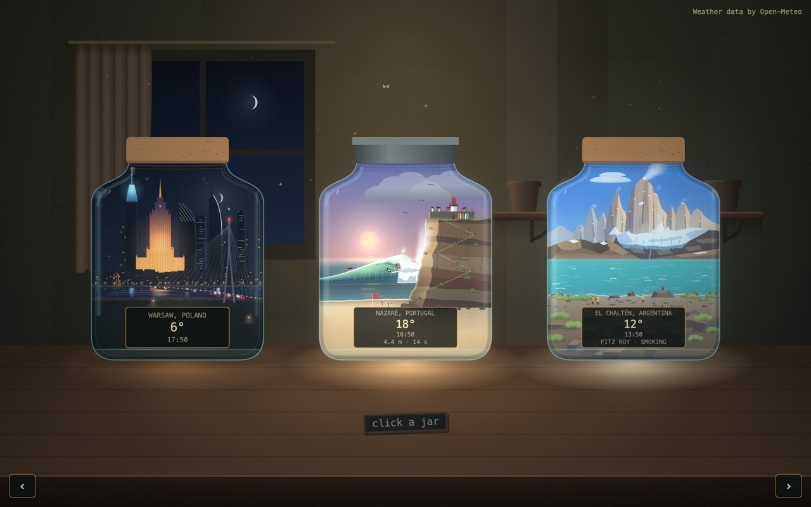
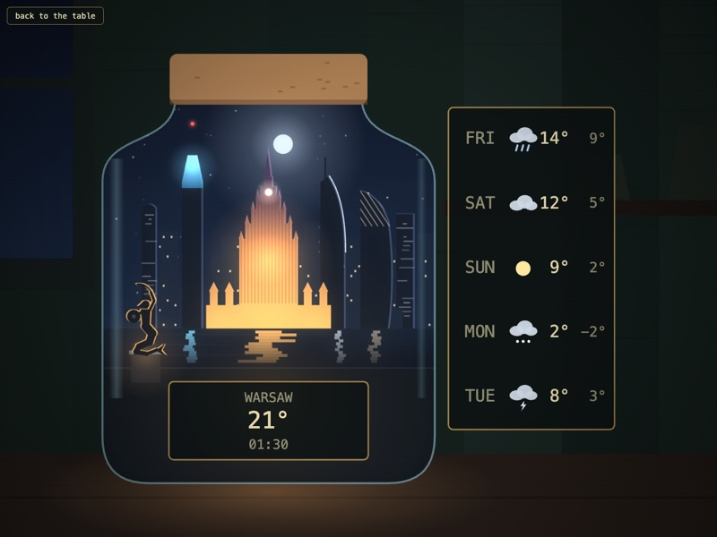
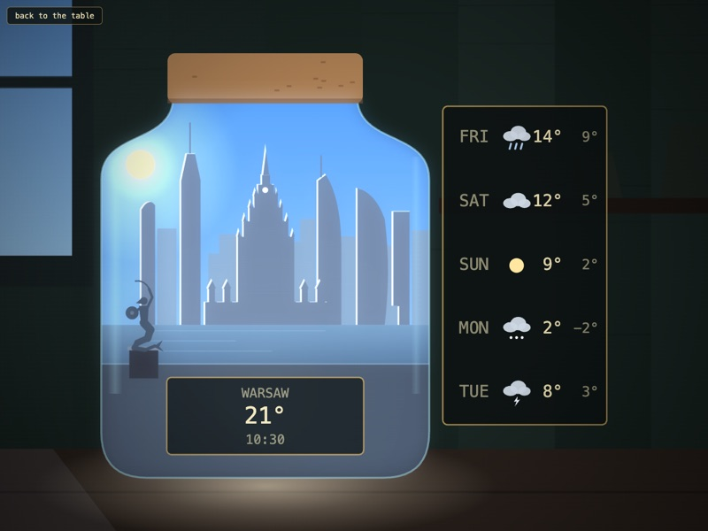
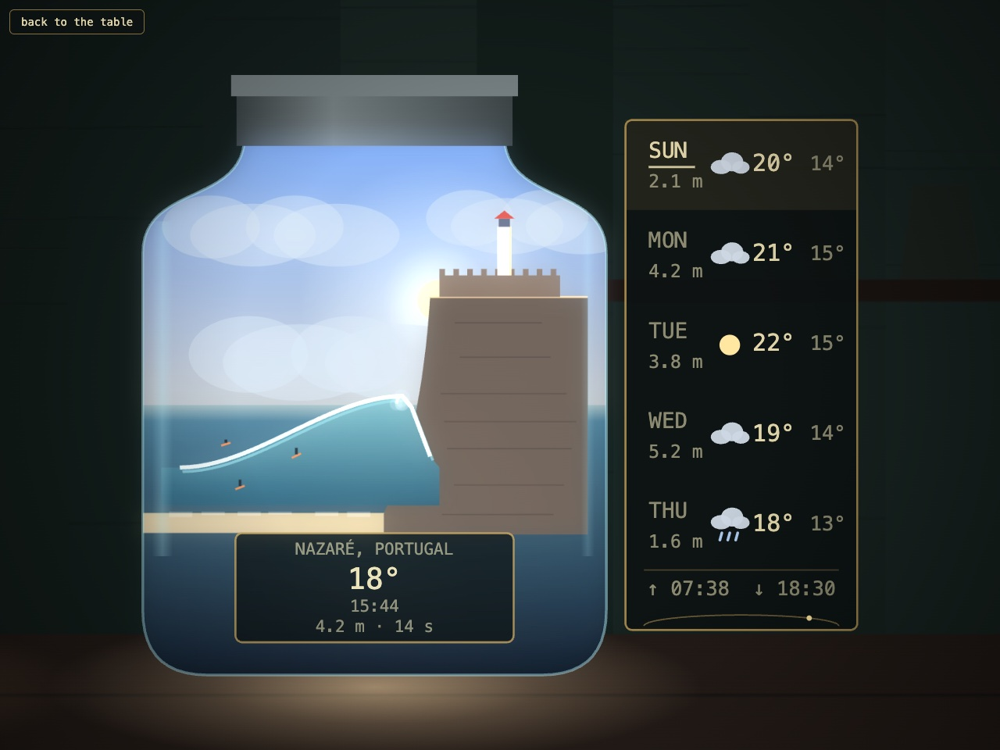
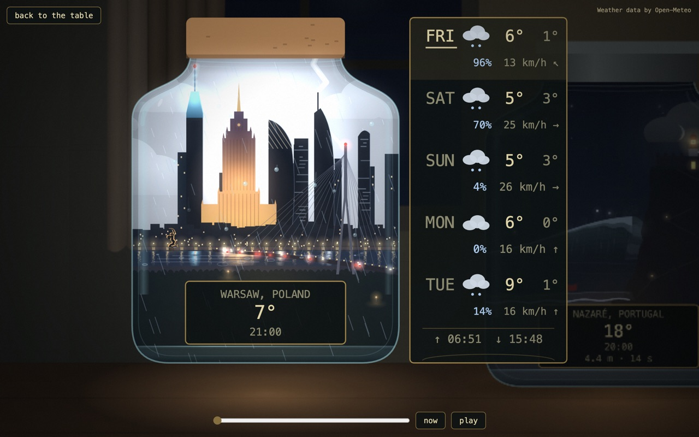
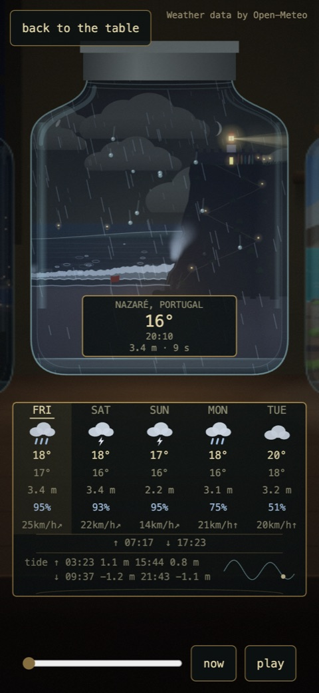
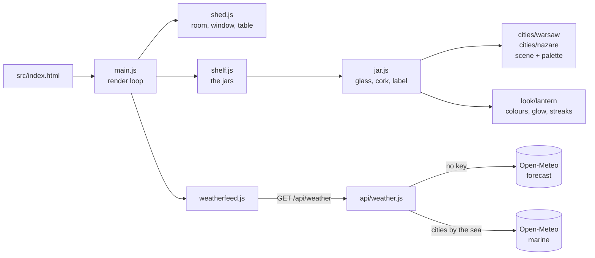
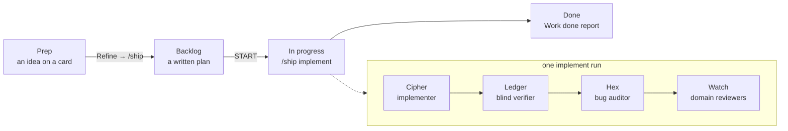

<p align="center">
  
</p>

<h1 align="center">jar</h1>

<p align="center">
  
  
  
  
  
</p>

**A garden shed at night, and a city in a jar.** On the potting table stand two
glass jars glowing like lanterns. One holds a tiny **Warsaw**, the other the
cliff and the giant wave of **Nazaré**. Each is lit for the real time of day
there right now and drawn under the weather that place is really having. A label
on each glass gives the city and country, the temperature and the local time,
and on Nazaré's jar the swell as well.



## What you're looking at

**The moon is the real one.** The moon in the jars and in the window shows its phase for the moment, from a thin crescent to full, and on a new moon night it is almost gone.

**Click or tap a jar and it lifts closer.** A card beside it shows the next
five days: today is marked with a band and an underline (and named *today* for
screen readers), and a strip along the bottom gives today's sunrise and sunset
with a thin arc under it whose dot shows how far the sun has come across the
sky. On a lifted jar the arrows, the arrow keys or a swipe move to the other
jar. Press Escape or the back button to set it down. The shed's own window
follows *your* clock, not either city's. A slider under the lifted jar previews
the next 24 hours (the light and the hourly weather, with the label marked
"+5 h"); let go of it or press *now* and the jar snaps back to the present.

<table>
  <tr>
    <td width="50%"></td>
    <td width="50%"></td>
  </tr>
  <tr>
    <td align="center"><b>Night: the Floodlit Nocturne.</b> The Palace glows gold, Varso's crown glows blue under a red needle light, and the towers reflect in the river.</td>
    <td align="center"><b>Day: rim-lit silhouettes.</b> Each tower has a bright edge on the side the sun is on. At dusk the two blend.</td>
  </tr>
</table>

The skyline is the downtown cluster: the Cosmopolitan, Varso, the Palace of
Culture and Science, Warsaw Spire, Złota 44 and the InterContinental. The
Mermaid stands on the left bank with her sword raised. The jar's glass streaks
sit at the edges of the glass, so they never cover a tower.

### The second jar: Nazaré

<table>
  <tr>
    <td width="62%"></td>
    <td width="38%">
      <b>A wave sized by the real sea.</b> The Sítio cliff, the São Miguel Arcanjo fort and its red-roofed lighthouse stand above the Praia do Norte wave. By day a few surfers ride it; at night the lighthouse beam sweeps the foam.<br><br>
      The wave's size follows the real wave height off the coast: <b>calm</b> under 1 m, <b>moderate</b> 1–3 m, <b>big</b> 3–6 m, <b>giant</b> from 6 m. With no reading it shows a moderate two-metre day.<br><br>
      The label adds the swell (height · period) as a fourth line, and the forecast card gives each day's peak wave height. The jar keeps Lisbon time and wears a tin lid instead of Warsaw's cork.
    </td>
  </tr>
</table>

<table>
  <tr>
    <td width="62%"></td>
    <td width="38%"></td>
  </tr>
  <tr>
    <td align="center"><b>Real weather.</b> Each jar shows rain, snow (with caps on the roofs), fog, dew on the glass, drifting clouds, wind and lightning. When a new wind reading arrives, the clouds carry on from where they are instead of jumping.</td>
    <td align="center"><b>Phone and laptop</b> share one drawing, so the jars look the same on both. The forecast moves under the jar on a phone, and a swipe moves between jars.</td>
  </tr>
</table>

## How it's made

One static page with Canvas 2D and ES modules. There is no build step and there
are no runtime libraries; everything is drawn in code. One small Vercel Node
function (`api/weather.js`) fetches the weather for every city from Open-Meteo,
and the wave height for any city by the sea from Open-Meteo's marine service, in
parallel. Neither needs a key, and a failed marine answer never fails the
weather: the wave just falls back to two metres.



- **The look is called Lantern.** It is named in exactly one place,
  `src/look/index.js` (`export const LOOK = 'lantern'`). Every colour, lighting
  rule and drawing primitive lives under `src/look/lantern/`.
- **A city's colours live in its own palette.** The lint fails on a colour
  literal anywhere else under `src/`.
- **The same moment draws the same picture.** Draw code never calls
  `Math.random` or reads the wall clock, and the smoke check hashes a pinned
  frame twice to prove it.
- The clock logic is adapted from Memory Lane (`../vir-sunset`) and credited
  in the file headers. None of the visual code comes from there.

## Quick start

```bash
npm install
npm run serve        # http://localhost:5173  (PORT=... to change it)
```

**You'll see:** the shed, with the Warsaw and Nazaré jars glowing on the table.
Open <http://localhost:5173/?jar=warsaw> or <http://localhost:5173/?jar=nazare>
to start with that jar already lifted.

The local server also answers `GET /api/weather` with the real function. To
try a particular weather without waiting for it, answer the weather from a
file (dev only):

```bash
WEATHER_FIXTURE=test/fixtures/weather-storm.json npm run serve
# also: weather-hail.json, weather-fog.json, weather-nowind.json, weather-cloudy-wind.json

# both jars from one file (an array of two vendor bodies), and the sea on demand:
WEATHER_FIXTURE=test/fixtures/weather-two-cities.json \
MARINE_FIXTURE=test/fixtures/marine.json npm run serve
```

With only `WEATHER_FIXTURE` set, the marine call is refused, so a fixture run
never reaches the network and Nazaré shows its two-metre default.

To see dew, open the page with the fog fixture, then run this in the browser
console:
`__jar.applyWeather({"current":{"temperature_2m":9,"weather_code":0,"cloud_cover":5,"is_day":1}})`

### URL options

| Option | What it does |
|---|---|
| `?jar=warsaw`, `?jar=nazare` | Opens straight onto that jar, lifted. |
| `?day=`, `?at=`, `?clock=` | Parsed by `readOptions` for a later card. The page always runs on the real clocks. |

## How work happens here

This project is built with **[Dark Army](https://github.com/androszr/dark-army)**,
which provides the board, the agents and the skills. Every change starts as a
card and ends as a reviewed commit. Agents do the typing; a person makes three
calls: what to build, when to start, and whether it's done.



| Skill | What it does |
|---|---|
| `/ship <idea>` | Asks a few questions, writes a plan to `plans/` and files it as a Backlog card. |
| `/ship implement <plan>` | Implements the plan, then runs a blind verify, a bug scan and the domain reviews, and ends with a `## Work done` report. |
| `/review` | Reviews a change in plain language and gives a SHIP or STOP verdict. |
| `/security-pass` | Audits dependencies, scans for secrets, and checks the bundle and headers. |
| `/deploy-web` | The runbook for CI, previews and production deploys. |

The agent briefs live in `.claude/agents/` (`jar-planner`, `jar-implementer`,
`jar-verifier`, `jar-bug-auditor`, `jar-integration-reviewer`,
`jar-security-reviewer`). The working agreement every assistant follows is
`AGENTS.md`. The architecture, the gates and the house rules are in
[`docs/context.md`](docs/context.md).

## Gates

```bash
npm run lint                      # syntax + house rules (tools/lint.mjs)
npm test                          # unit tests (node --test)
SMOKE_TIMING=off npm run smoke    # headless Chromium; drop SMOKE_TIMING=off to hold frame budgets
```

The smoke check drives a real page. It pins a Warsaw night and a Warsaw
morning and samples pixels to check the gold Palace, the blue crown, the red
light, the reflections, the Mermaid's rim and the morning rim. For Nazaré it
checks both labels, both lifts, moving between jars by arrow and by swipe, the
four wave sizes and their surfers, and the lighthouse beam at night. It also
checks the forecast card's today mark, sunrise and sunset strip and sun arc,
and that clouds hold their place when the wind changes. Its screenshots
go to `test-output/`, which is where the pictures above come from. It needs a
Chromium: run `npx playwright-core install chromium-headless-shell`, or it
falls back to an installed Chrome. The weather is stubbed in every test and in
the smoke check, so nothing touches the network.

## Adding a city

1. Add `{ id, title, country, lat, lon, zone }` to `src/cities/places.js`.
   Append, never insert: the order is the weather request's order. An optional
   `sea: { lat, lon }` is an offshore point the weather function also reads the
   wave height at; a city without one makes no marine call. A city with a `sea`
   point also gets the swell as a fourth label line and a peak wave height per
   day on its card.
2. Copy `src/cities/warsaw/` to `src/cities/<id>/`, write its `palette.js` and
   scene, and fill in `index.js`, including `country: place.country`. The
   contract is the comment at the top of `src/cities/index.js`. A scene that
   moves on the clock (like Nazaré's rolling sea) can export
   `cadenceMs(weather, { reduced })`, the milliseconds between redraws it needs;
   the page redraws at the shortest interval any city or the weather asks for.
3. Import it and add it to `CITIES` in `src/cities/index.js`.

`npm run lint` fails if a city folder is listed in only one of the two
registries. Each jar holds one city.

## Switching the look

To switch looks, add `src/look/<name>/` exporting the same surface as Lantern.
The list of exports is in `src/look/index.js` and is checked by
`test/look.test.js`. Then change the `LOOK` constant and the `export * from`
line. The other candidates are **Toybox** (bright isometric, flat-shaded
low-poly) and **Pixel** (a cosy pixel-art diorama).

## Hosting

`vercel.json` publishes `src/` as it is and gives every response a self-only
CSP (`connect-src 'self'`): the page only ever talks to its own `/api/weather`,
and the function is the only thing that calls Open-Meteo. `/api/*` is cached for
15 minutes at the edge.

- **A pull request** gets a preview deploy.
- **A push to `main` goes live**, after the gates pass. The deploy runs from
  `.github/workflows/deploy.yml` with a pinned Vercel CLI.

You need to create the Vercel project and its three secrets yourself:
`VERCEL_TOKEN`, `VERCEL_ORG_ID` and `VERCEL_PROJECT_ID`.
